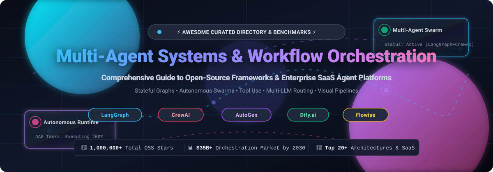

<div align="center">

<a href="https://github.com/ishandutta2007/Awesome-Multi-Agent-Systems-Workflow-Orchestration">
  
</a>

# Awesome Multi-Agent Systems & Workflow Orchestration 🤖⚡

<a href="https://github.com/ishandutta2007/Awesome-Awesome-Awesome"></a><a href="https://discord.gg/jc4xtF58Ve"></a>
[](https://github.com/ishandutta2007/Awesome-Awesome-Awesome)
[](https://github.com/ishandutta2007/Awesome-Multi-Agent-Systems-Workflow-Orchestration/stargazers)
[](https://opensource.org/licenses/MIT)
[](https://github.com/ishandutta2007/Awesome-Multi-Agent-Systems-Workflow-Orchestration/pulls)
[](https://github.com/ishandutta2007/Awesome-Multi-Agent-Systems-Workflow-Orchestration/graphs/commit-activity)
<a href="https://github.com/ishandutta2007"></a>

**A curated, authoritative directory of top Multi-Agent Systems (MAS), autonomous agent frameworks, and agentic workflow orchestration platforms.** Discover both production-ready Enterprise SaaS platforms and community-driven Open-Source software for stateful graphs, autonomous swarms, RAG pipelines, visual DAG builders, and LLM agent orchestration. 🌟🚀

---

📑 [Sector Overview](#sector-overview--market-dynamics-) • ☁️ [SaaS Platforms](#saas--hosted-platforms-) • 💻 [Open-Source Ecosystem](#open-source-frameworks--platforms-) • 🏗️ [Architectural Comparison](#architectural-comparison-) • 🎯 [Key Selection Criteria](#key-selection-criteria-how-to-choose-) • 📈 [Star History](#star-history-) • 💖 [Support](#support-) • 🤝 [Contributing](#contributing-)

</div>

---

## 📊 Sector Overview & Market Dynamics 🌐

The global **AI Agent Workflow Orchestration** and agentic infrastructure market is projected to expand from **$8.44 Billion in 2024** to over **$35.3 Billion by 2030** (CAGR ~28.5%), propelled by enterprises shifting from single-turn chat assistants to autonomous, multi-step agentic execution. The sector currently exhibits a **hybrid, bifurcated market structure**: it is **highly fragmented** at the developer and framework layer—where numerous venture-backed startups and open-source projects compete aggressively on memory architectures, cycle execution, and tool routing—while remaining **moderately concentrated** at the enterprise deployment layer around hyperscalers and full-stack governance platforms offering turnkey security, SOC2/HIPAA compliance, and unified RBAC. 📈🔍

---

## ☁️ SaaS & Hosted Platforms 🏢

A comprehensive tabular breakdown of managed, enterprise, and hosted multi-agent orchestration platforms. Entries are sorted descending by company size (valuation / acquisition price).

| 🏢 Platform | 💰 Valuation / Company Size | 🏷️ Pricing (Starting Tier) | 🎁 Free Tier Limit | 🚀 Primary Focus / Key Capabilities |
| :--- | :--- | :--- | :--- | :--- |
| **[LangGraph Platform](https://www.langchain.com/langgraph)** (LangChain) | **$3.0 Billion** (Series C valuation) | **$39 / user / month** (*Plus Plan* for team collaboration; base node execution at ~$0.001/step) | **Developer Plan (Free for life)**: 1 seat, up to 5,000–10,000 traces/mo with 14-day data retention | Production-grade deployment control plane for LangGraph, streaming human-in-the-loop workflows, state persistence, and LangSmith observability. 🔄 |
| **[Dify Cloud](https://dify.ai/)** | **$180 Million** (Series Pre-A post-money) | **$59 / month** (*Professional Plan*, up to 3 team members, 5,000 messages/mo) | **Sandbox Plan (Free for life)**: 1 member, 200 one-time LLM message credits, 5 apps, 50MB knowledge base storage | Visual LLM application and multi-agent workflow builder, RAG engine, tool calling, and full enterprise lifecycle management. 🧩 |
| **[Botpress Cloud](https://botpress.com/)** | **$120 Million** (Series B post-money) | **$495 / month** (*Team Plan*; Pay-as-you-go base starts at $0 + consumption) | **Free Plan (Free for life)**: 1 collaborator seat, 50 conversations/mo, $5 free AI credits, 100MB file/vector storage | Enterprise-grade conversational AI platform, multi-agent bot orchestration, visual flow editor, and autonomous knowledge agents. 💬 |
| **[Stack AI](https://www.stack-ai.com/)** | **$75 Million** (Acquired by Asana) | **Enterprise Custom** (Starting at custom contract tiers for production workloads) | **Free Plan (Free for life)**: 1 user seat, 2 active projects, 500 workflow runs/month | Enterprise workflow builder connecting LLMs, document extractors, internal APIs, and multi-agent automations into business processes. ⚙️ |
| **[Letta Cloud](https://www.letta.com/)** (formerly MemGPT) | **$70 Million** (Seed post-money) | **$20 / month** (*Pro Plan*, up to 20 stateful agents + managed model quota) | **Free Plan (Free for life)**: Up to 3 stateful memory agents, BYOK (Bring Your Own Keys), unlimited agent memory storage | Stateful LLM services offering perpetual multi-agent memory, cognitive architectures, and agent-to-agent communication. 🧠 |
| **[CrewAI Enterprise](https://www.crewai.com/)** | **~$76 Million** (Series A valuation estimate) | **$99 / month** (*Team Plan* / Starter Cloud deployment; OSS core free) | **Basic Plan (Free for life)**: Visual editor, GitHub sync, 50 workflow executions/month | Enterprise multi-agent orchestration for role-playing autonomous agents, deterministic process routing, and corporate governance. 👥 |
| **[Flowise Cloud](https://flowiseai.com/)** | **Seed Stage** (Venture-backed OSS) | **$35 / month** (*Starter Plan*, unlimited flows, 10,000 predictions/mo, 1GB storage) | **Free Plan (Free for life)**: 2 active canvas flows, 2,000 predictions/month, 5MB file storage | Low-code drag-and-drop user interface for building LangChain, LlamaIndex, and multi-agent systems via visual canvas. 🎨 |
| **[Fixie.ai](https://www.fixie.ai/)** | **$17 Million** (Seed round funding) | **$100 / month** (*Pro Plan*; Ultravox voice processing consumption tiers) | **Free Tier (Free to start)**: Pay-as-you-go with initial trial usage allowance, community support | Real-time multi-modal and voice agent orchestration, ultra-low-latency voice AI pipeline integration (Ultravox). 🎙️ |
| **[SuperAGI Cloud](https://superagi.com/)** | **Seed Stage** (Dev-first platform) | **$49 / user / month** (*Pro Plan* with concurrent agent loops & cloud workers) | **Lite Plan (Free for life)**: 1 user seat, 100 credits/month, access to core agent templates and tools | Infrastructure for building, managing, and running autonomous agent swarms, action consoles, and tool marketplaces. ⚡ |
| **[KunAgent Cloud / Pro](https://kun-agent.com/)** | **Bootstrapped / Early Venture** | **Free for Non-Commercial** (Commercial licenses require custom enterprise authorization) | **Full Free for Non-Commercial (Free for life)**: 100% features enabled for personal use via Bring-Your-Own-Key (BYOK) | Local-first and hosted AI workbench with dual desktop GUI and terminal TUI runtimes for agentic coding and automation workflows. 💻 |

---

## 💻 Open-Source Frameworks & Platforms 🌟

A curated compilation of premier open-source multi-agent systems, autonomous runtime engines, and workflow frameworks. Sorted descending by GitHub stargazers count with verified social badges linking directly to their stargazers page.

| 📦 Repository | ⭐ GitHub Stars Badge | 💻 Language | 📝 Description & Core Strengths |
| :--- | :--- | :--- | :--- |
| **[AutoGPT](https://github.com/Significant-Gravitas/AutoGPT)** | [](https://github.com/Significant-Gravitas/AutoGPT/stargazers) | Python | Pioneering autonomous general-purpose agent framework with agent loops, memory management, and block-based workflow creation. 🤖 |
| **[Dify](https://github.com/langgenius/dify)** | [](https://github.com/langgenius/dify/stargazers) | Python / TypeScript | Open-source LLM app development platform combining visual multi-agent workflow orchestration, RAG pipelines, and model evaluation. 🛠️ |
| **[LangChain](https://github.com/langchain-ai/langchain)** | [](https://github.com/langchain-ai/langchain/stargazers) | Python / TypeScript | Industry-standard foundation framework for chaining LLMs, integrating vector databases, building tools, and powering agentic workflows. 🔗 |
| **[Browser-Use](https://github.com/browser-use/browser-use)** | [](https://github.com/browser-use/browser-use/stargazers) | Python | Powerful open-source agent framework specifically optimized for controlling web browsers, web scraping, and interacting with arbitrary web apps. 🌐 |
| **[OpenHands](https://github.com/OpenHands/OpenHands)** | [](https://github.com/OpenHands/OpenHands/stargazers) | Python / TypeScript | Autonomous software development agent (formerly OpenDevin) capable of writing code, debugging, executing bash commands, and collaborating. 💻 |
| **[MetaGPT](https://github.com/FoundationAgents/MetaGPT)** | [](https://github.com/FoundationAgents/MetaGPT/stargazers) | Python | Multi-agent framework that assigns diverse personas (Product Manager, Architect, Project Manager, Engineer) to simulate an entire software company. 🏢 |
| **[Microsoft AutoGen](https://github.com/microsoft/autogen)** | [](https://github.com/microsoft/autogen/stargazers) | Python / C# | Modular programming framework for building next-generation multi-agent conversation systems with customizable agents and human-in-the-loop support. 🤝 |
| **[CrewAI](https://github.com/crewAIInc/crewAI)** | [](https://github.com/crewAIInc/crewAI/stargazers) | Python | Intuitive role-playing multi-agent orchestration framework enabling autonomous agents to collaborate, delegate subtasks, and solve complex goals. 👥 |
| **[Flowise](https://github.com/FlowiseAI/Flowise)** | [](https://github.com/FlowiseAI/Flowise/stargazers) | TypeScript | Visual node-based UI drag-and-drop tool to construct and deploy LLM orchestration pipelines, multi-agent flows, and interactive assistants. 🎨 |
| **[LangGraph](https://github.com/langchain-ai/langgraph)** | [](https://github.com/langchain-ai/langgraph/stargazers) | Python / TypeScript | Library for building resilient, cyclic, stateful multi-actor applications with LLMs; ideal for deterministic graphs, persistence, and checkpointing. 🕸️ |
| **[ChatDev](https://github.com/OpenBMB/ChatDev)** | [](https://github.com/OpenBMB/ChatDev/stargazers) | Python | Virtual software company driven by multi-agent collaboration with specialized roles executing custom design, coding, testing, and documentation phases. 👥 |
| **[Semantic Kernel](https://github.com/microsoft/semantic-kernel)** | [](https://github.com/microsoft/semantic-kernel/stargazers) | C# / Python / Java | Microsoft enterprise orchestration SDK integrating conventional programming with LLM plugins, memory planners, and multi-agent coordination. ⚙️ |
| **[Haystack](https://github.com/deepset-ai/haystack)** | [](https://github.com/deepset-ai/haystack/stargazers) | Python | Production-ready open-source LLM orchestration framework for building flexible pipelines, modular search systems, and deterministic agent workflows. 🌾 |
| **[Letta](https://github.com/letta-ai/letta)** | [](https://github.com/letta-ai/letta/stargazers) | Python | Framework for building stateful LLM agents with perpetual memory hierarchies (formerly MemGPT), letting agents edit and persist long-term context. 🧠 |
| **[Agent Zero](https://github.com/agent0ai/agent-zero)** | [](https://github.com/agent0ai/agent-zero/stargazers) | Python / Docker | Dynamic, organic, and personal AI agent that can write code, run commands in an isolated Docker sandbox, and dynamically instantiate subagents. 🔬 |
| **[CAMEL](https://github.com/camel-ai/camel)** | [](https://github.com/camel-ai/camel/stargazers) | Python | Pioneering framework for communicative agent research and autonomous cooperative multi-agent problem-solving through inception prompting. 🐪 |
| **[SuperAGI](https://github.com/TransformerOptimus/SuperAGI)** | [](https://github.com/TransformerOptimus/SuperAGI/stargazers) | Python | Dev-first autonomous agent infrastructure offering multi-model support, agent telemetry, tool marketplace, concurrent loops, and graphical consoles. ⚡ |
| **[Botpress](https://github.com/botpress/botpress)** | [](https://github.com/botpress/botpress/stargazers) | TypeScript | The open-source builder and engine to create, customize, and orchestrate modern LLM chatbots and conversational agent swarms. 🤖 |
| **[Swarms](https://github.com/kyegomez/swarms)** | [](https://github.com/kyegomez/swarms/stargazers) | Python | Modular enterprise framework for coordinating swarms of AI agents across diverse architectures (hierarchical, round-robin, consensus-driven). 🐝 |
| **[Kun](https://github.com/KunAgent/Kun)** | [](https://github.com/KunAgent/Kun/stargazers) | Rust / Go / Python | Local-first personal AI agent workbench providing both desktop graphical UI and terminal TUI runtimes for coding, research, and system automation. 🖥️ |
| **[AG2](https://github.com/ag2ai/ag2)** | [](https://github.com/ag2ai/ag2/stargazers) | Python | Community-driven evolution of AutoGen designed as the open-source "AgentOS" for scalable multi-agent application architectures. 🌐 |

---

## 🏗️ Architectural Comparison 📐

```
┌────────────────────────────────────────────────────────────────────────┐
│                        AGENT APPLICATION LAYER                         │
│   (Customer Service, Code Generation, Autonomous Research, RPA Bots)   │
└───────────────────────────────────┬────────────────────────────────────┘
                                    │
       ┌────────────────────────────┴───────────────────────────┐
       ▼                                                        ▼
┌───────────────────────────────┐        ┌───────────────────────────────┐
│     STATEFUL GRAPH FLOWS      │        │    ROLE-PLAYING SWARMS        │
│  (LangGraph, Haystack, AG2)   │        │  (CrewAI, MetaGPT, ChatDev)   │
│  • Cyclic State & Time Travel │        │  • Persona Delegation         │
│  • Deterministic Guardrails   │        │  • Collaborative Consensus    │
│  • Human-in-the-Loop Pauses   │        │  • Dynamic Subtask Spawning   │
└──────────────┬────────────────┘        └──────────────┬────────────────┘
               │                                        │
               └────────────────────┬───────────────────┘
                                    │
                                    ▼
┌────────────────────────────────────────────────────────────────────────┐
│                      SHARED AGENT INFRASTRUCTURE                       │
│  • Memory & State Stores: Letta, Mem0, Redis, PostgreSQL, SQLite       │
│  • Tools & Sandbox Execution: Docker, E2B, Browser-Use, Playwright     │
│  • Multi-LLM Routing: LiteLLM, Ollama, OpenAI, Anthropic, Gemini, Grok │
│  • Observability & Tracing: LangSmith, Langfuse, Arize Phoenix         │
└────────────────────────────────────────────────────────────────────────┘
```

---

## 🎯 Key Selection Criteria: How to Choose? 🤔

1. **For Cyclic, Complex, & Mission-Critical Workflows:**  
   Choose **[LangGraph](https://github.com/langchain-ai/langgraph)** or **[Haystack](https://github.com/deepset-ai/haystack)**. They provide deterministic graph transitions, state checkpointing, and robust human-in-the-loop approvals. 🔄
2. **For Task Delegation & Persona Simulation:**  
   Choose **[CrewAI](https://github.com/crewAIInc/crewAI)** or **[MetaGPT](https://github.com/FoundationAgents/MetaGPT)**. These excel when distinct virtual roles (e.g. researcher, writer, QA tester) need to collaborate to deliver an end-to-end artifact. 👥
3. **For Low-Code, Fast Prototyping, & Visual Builders:**  
   Choose **[Dify](https://github.com/langgenius/dify)** or **[Flowise](https://github.com/FlowiseAI/Flowise)**. They offer intuitive canvas editors, built-in RAG modules, and turnkey API deployment. 🎨
4. **For Long-Term Stateful Memory:**  
   Choose **[Letta](https://github.com/letta-ai/letta)**. Letta's memory tiering ensures agents retain knowledge across infinite conversational sessions without exceeding model context limits. 🧠
5. **For Browser Automation & Web RPA:**  
   Choose **[Browser-Use](https://github.com/browser-use/browser-use)**. It provides specialized vision-based browser control for interacting with dynamic websites. 🌐

---

## 📈 Star History 📊

#[](https://star-history.dera.page/#ishandutta2007/Awesome-Multi-Agent-Systems-Workflow-Orchestration&type=date&legend=top-left)`
[](https://www.star-history.com/#ishandutta2007/Awesome-Multi-Agent-Systems-Workflow-Orchestration&type=date&legend=top-left)`

---

## 💖 Support & Sponsoring ☕

A heartfelt thank you for visiting and using this curated directory! If you find this repository valuable, please consider supporting the project:

- ⭐ **Star this repository** to help others discover it!
- 🍴 **Fork it** and contribute your own tools, frameworks, and insights.
- 📢 **Share it** on Twitter/X, LinkedIn, Discord, and Reddit with fellow AI engineers and researchers.
- ☕ **Buy me a coffee / Sponsor**: Support ongoing maintenance and curation via the [GitHub Sponsors Dashboard](https://github.com/sponsors/ishandutta2007).

Your support keeps this project active, comprehensive, and up-to-date with the fastest-moving sector in AI! 🙌

---

## 🤝 Contributing 🚀

Contributions are always welcome! 

1. Review our submission guidelines.
2. Fork this repository and create a new feature branch (`git checkout -b feature/new-framework`).
3. Add your entry into the relevant SaaS or Open-Source section in **alphabetical or correctly sorted order**.
4. Verify all badge links, stargazers counts, and pricing specifications.
5. Open a Pull Request with a clear description of the project.

---

## 📄 License 📜

This curated list is open-source and released under the [MIT License](LICENSE).
